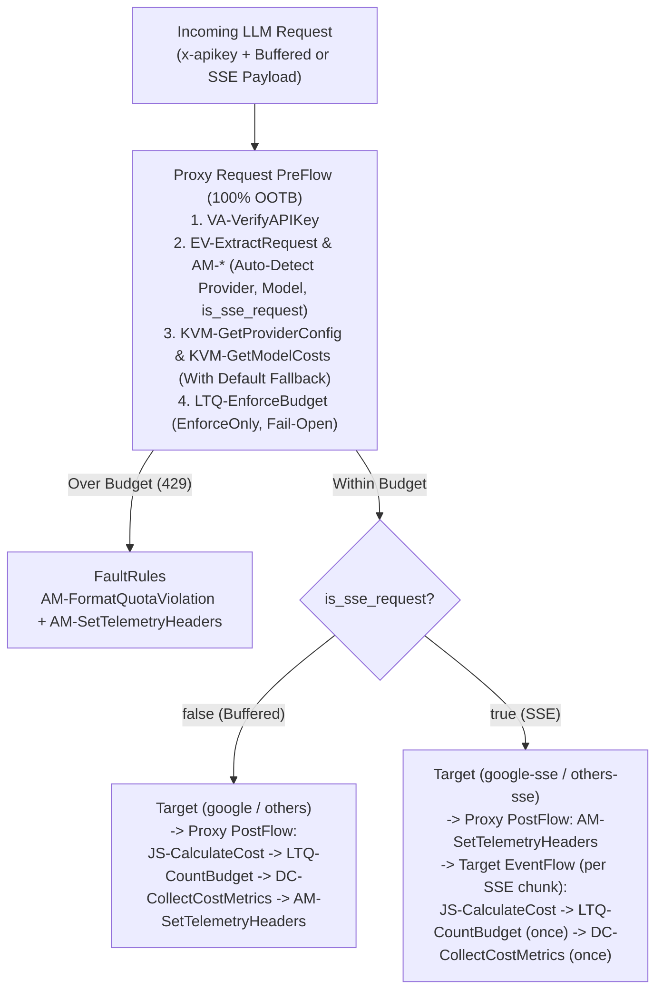

# Plug-and-Play Buffered & SSE LLM Budget Control (`LLMTokenQuota`)

This sample provides a turnkey, unified **Apigee X / Apigee hybrid** API Proxy (`llm-budget-control-sse`) that enforces and counts **micro-dollar (`1/1,000,000` USD)** LLM budgets across **both standard buffered (`application/json`) and streaming Server-Sent Events (`text/event-stream`)** responses using Apigee's native `LLMTokenQuota` policy and `<EventFlow>`.

See [simplified_proxy_flow.md](./simplified_proxy_flow.md) for a visual architectural walkthrough.

---

## Key Capabilities

1. **Unified Buffered + SSE Micro-Dollar Wallet**:
   - Uses `LTQ-EnforceBudget` (`EnforceOnly`) and `LTQ-CountBudget` (`CountOnly`) sharing `<SharedName>llm_budget_quota</SharedName>`, `<Identifier ref="developer.app.id"/>`, and `<LLMModelSource>all-models</LLMModelSource>`.
   - Buffered calls, streaming SSE calls, and calls across different models (`gemini-2.5-flash`, `gemini-2.5-pro`, `gpt-4o`, `claude-sonnet-4-20250514`) all deduct from **one isolated monthly micro-dollar wallet per Developer App**.
2. **100% Out-of-the-Box (OOTB) Request `PreFlow`**:
   - Authentication (`VA-VerifyAPIKey`), URI/JSON extraction (`EV-ExtractRequest`), provider & SSE auto-detection (`AssignMessage`), KVM lookups (`KVM-GetProviderConfig`, `KVM-GetModelCosts`), and pre-flight budget enforcement (`LTQ-EnforceBudget`) use pure OOTB policies—leaving `JS-CalculateCost` as the **only** JavaScript policy in the proxy.
3. **Accurate Terminal-Chunk SSE Cost Counting**:
   - Inside `<EventFlow content-type="text/event-stream">`, `JS-CalculateCost` inspects each SSE event and sets `should_record_cost = "true"` **only once on the terminal usage chunk** (`candidates[0].finishReason` for Vertex AI Gemini, final `usage` chunk for OpenAI, or `message_delta` for Anthropic), preventing multi-chunk `promptTokenCount` overcharging and `[DONE]` metric overwrites.
4. **Consistent Pre-Flight Telemetry Headers**:
   - Emits the exact same 7 `x-llm-*` routing and opening-balance headers across Buffered (`200 OK`), Streaming SSE (`200 OK`), and Over-Budget (`429`) responses, while capturing exact post-response token counts and micro-dollar costs identically in **Apigee Analytics** via `DC-CollectCostMetrics`.
5. **Composable via Proxy Chaining (`LocalTargetConnection`)**:
   - Existing Apigee proxies (e.g., Model Armor security or semantic caching) can chain to `/v2/samples/llm-budget-control-sse` in-memory with zero network hop so every proxy in the environment shares one unified budget counter per App.

---

## Architecture



---

## Unified Telemetry Header Contract

Because HTTP headers in SSE are flushed to the client before tokens finish streaming, `AM-SetTelemetryHeaders` exposes the **opening budget state checked prior to the current request** across all modes:

| Header | Description | Buffered (`200`) | SSE (`200`) | Over Budget (`429`) |
| :--- | :--- | :---: | :---: | :---: |
| `x-llm-provider` | Resolved LLM provider (`google`, `openai`, `anthropic`) | Yes | Yes | Yes |
| `x-llm-model` | Resolved model ID | Yes | Yes | Yes |
| `x-llm-streaming` | `"true"` for SSE streams, `"false"` for buffered JSON | `"false"` | `"true"` | `"false"` / `"true"` |
| `x-llm-budget-limit-micro` | App's period budget limit in micro-dollars (`1000000` = `$1.00`) | Yes | Yes | Yes |
| `x-llm-budget-used-before-request-micro` | Cumulative micro-dollars spent **before** this request arrived | Yes | Yes | Yes |
| `x-llm-budget-remaining-before-request-micro` | Micro-dollars remaining **before** this request arrived | Yes | Yes | `"0"` |
| `x-llm-budget-reset-utc` | Quota reset timestamp in UTC epoch milliseconds | Yes | Yes | Yes |

Post-response per-request token counts and micro-dollar costs are captured identically in Apigee Analytics via `dc_llm_provider`, `dc_llm_model`, `dc_llm_prompt_tokens`, `dc_llm_candidates_tokens`, and `dc_llm_transaction_cost_v2`.

---

## Prerequisites

- An **Apigee X** or **Apigee hybrid** organization with the Vertex AI API enabled (`aiplatform.googleapis.com`).
- `gcloud`, `curl`, `jq`, and `python3` installed and authenticated (`gcloud auth login`).
- `apigeecli` installed (automatically installed by the deployment script if missing).

---

## Quickstart Deployment & Verification

### 1. Clone & Configure `env.sh`

```bash
git clone https://github.com/tarunabraham1986/apigee-llm-budget-control-sse.git
cd apigee-llm-budget-control-sse
```

Edit `env.sh` with your Google Cloud / Apigee X settings:

```bash
export PROJECT="your-gcp-project-id"
export APIGEE_ENV="eval"
export APIGEE_HOST="your-apigee-domain.example.com"
export REGION="us-west1"
```

### 2. Run Offline Bundle Validation

```bash
python3 test/validate_bundle.py
```

### 3. Deploy Everything in One Command

```bash
./deploy-llm-budget-control-sse.sh
```

This idempotently provisions:
- Vertex AI Service Account (`apigee-llm-budget-sa`) with `roles/aiplatform.user`.
- `llm-model-costs` (with per-model rates + `default` fallback) and `llm-provider-config` KVMs.
- All 5 Analytics Data Collectors (`dc_llm_*`).
- `llm-budget-control-sse` API Proxy.
- Tiered API Products & fresh Developer Apps saved to `demo-keys.env`:
  - **Marketing App**: `20,000` micro-dollars (`$0.02` / month)
  - **Engineering App**: `1,000,000` micro-dollars (`$1.00` / month)

### 4. Run Interactive Notebook or CLI Traffic Simulation

- **Interactive Jupyter Notebook**: Open [`llm_budget_control_sse_demo.ipynb`](./llm_budget_control_sse_demo.ipynb) in VS Code or Jupyter (`pip install ipykernel httpx google-genai`) to step interactively through live Buffered + SSE streaming calls, cross-model wallet deductions, `429` exhaustion, tenant isolation, and `google-genai` SDK streaming.
- **CLI Traffic Simulation**:
  ```bash
  ./run-demo-traffic.sh
  ```

### 5. Run Automated E2E + Apigee Debug Session Trace Tests

```bash
python3 test/run_debug_tests.py
```

---

## Plug-and-Play Usage Examples

### Direct `curl` (Buffered vs. Streaming SSE)

```bash
source env.sh && source demo-keys.env

# 1. Buffered JSON call (no x-llm-provider header required)
curl -i -X POST \
  "https://${APIGEE_HOST}/v2/samples/llm-budget-control-sse/v1/projects/${PROJECT}/locations/${REGION}/publishers/google/models/gemini-2.5-flash:generateContent" \
  -H "x-apikey: ${ENGINEERING_KEY}" \
  -H "Content-Type: application/json" \
  -d '{"contents":[{"role":"user","parts":[{"text":"Explain micro-dollar LLM budgeting in one sentence."}]}]}'

# 2. Streaming SSE call (-N disables curl output buffering)
curl -N -i -X POST \
  "https://${APIGEE_HOST}/v2/samples/llm-budget-control-sse/v1/projects/${PROJECT}/locations/${REGION}/publishers/google/models/gemini-2.5-flash:streamGenerateContent?alt=sse" \
  -H "x-apikey: ${ENGINEERING_KEY}" \
  -H "Accept: text/event-stream" \
  -H "Content-Type: application/json" \
  -d '{"contents":[{"role":"user","parts":[{"text":"Stream a 3-bullet summary of Apigee EventFlow."}]}]}'
```

### Python `google-genai` SDK (Buffered & Streaming)

```python
import httpx
from google import genai
from google.genai import types
from google.oauth2.credentials import Credentials

client = genai.Client(
    vertexai=True,
    project="YOUR_PROJECT",
    location="us-west1",
    # Client needs zero GCP IAM permissions: Apigee authenticates via x-apikey
    credentials=Credentials(token="apigee-managed"),
    http_options=types.HttpOptions(
        base_url="https://YOUR_APIGEE_HOST/v2/samples/llm-budget-control-sse",
        headers={"x-apikey": "YOUR_APIGEE_KEY"},
        httpx_client=httpx.Client(timeout=60.0),
    ),
)

# Buffered
resp = client.models.generate_content(
    model="gemini-2.5-flash",
    contents="Hello from buffered mode!",
)
print(resp.text)

# Streaming SSE
for chunk in client.models.generate_content_stream(
    model="gemini-2.5-flash",
    contents="Hello from streaming SSE mode!",
):
    if chunk.text:
        print(chunk.text, end="", flush=True)
```

> **OpenAI Streaming Note:** When sending OpenAI `/v1/chat/completions` requests with `"stream": true`, include `"stream_options": {"include_usage": true}` in the JSON request body so OpenAI emits the final token `usage` summary chunk before `data: [DONE]`.

### Chaining from Existing Apigee Proxies (`LocalTargetConnection`)

To enforce a single shared per-App wallet across existing proxies (such as Model Armor security or semantic caching proxies), point their `TargetEndpoint` locally to `llm-budget-control-sse`:

```xml
<TargetEndpoint name="budget-governed-egress">
  <LocalTargetConnection>
    <APIProxy>llm-budget-control-sse</APIProxy>
    <ProxyEndpoint>default</ProxyEndpoint>
  </LocalTargetConnection>
</TargetEndpoint>
```

---

## Custom Analytics Report & Cleanup

After running demo traffic and waiting ~10–15 minutes for Apigee Analytics ingestion, optionally create the Custom Report:

```bash
./create-custom-report.sh
```

To tear down the deployed proxy and demo resources:

```bash
./clean-up-llm-budget-control-sse.sh
```

---

## License

Apache License 2.0 — see [LICENSE](./LICENSE).
