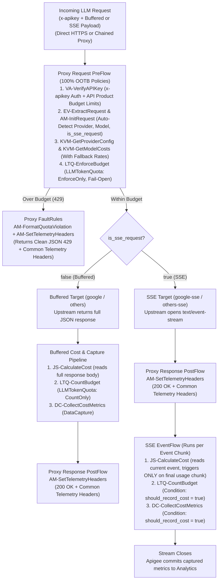
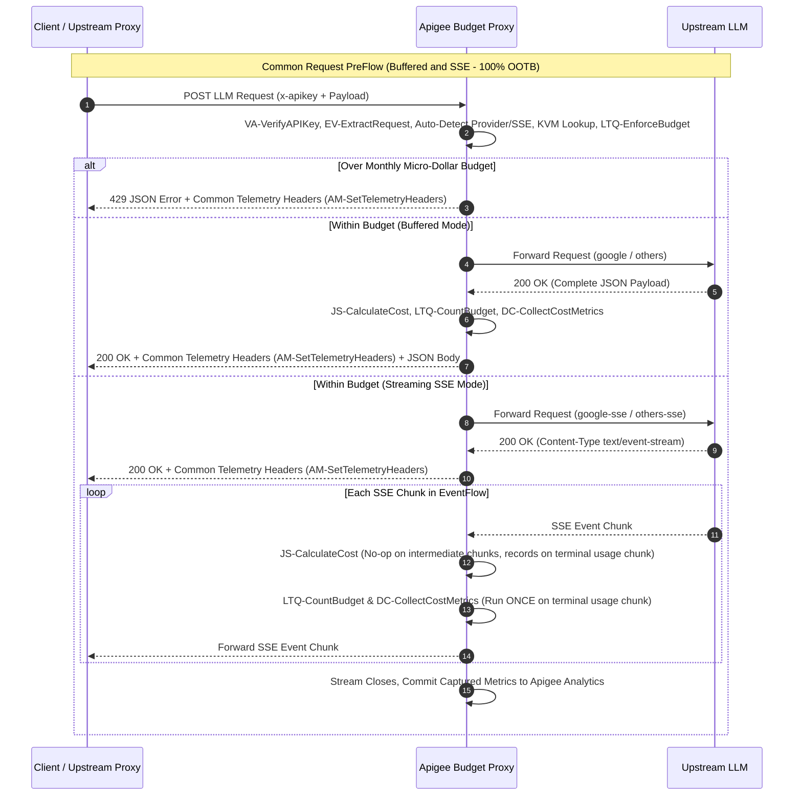
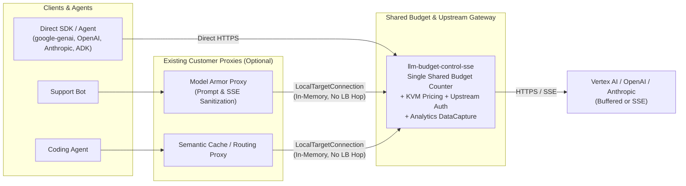

# Simplified Proxy Flow: Consistent & Plug-and-Play Buffered/SSE LLM Budget Control

## Overview

Eliminating the Shared Flow allows budget enforcement, micro-dollar cost calculation, analytics capture, and telemetry headers to live inside **one plug-and-play API Proxy** using a **single, unified set of policies**.

Every policy is defined once and behaves identically across both standard buffered (`application/json`) and streaming Server-Sent Events (`text/event-stream`) LLM responses, with zero request-side JavaScript, no cross-bundle quota counter scoping issues, and no mode-specific header discrepancies.

---

## End-to-End Proxy Flow

---

## Execution Timeline: Buffered vs. Streaming (SSE)

---

## The 4 Core Policy Building Blocks

### 1. Pre-Flight Request Gate (`ProxyEndpoint` Request `PreFlow` — 100% OOTB Policies)
- **`VA-VerifyAPIKey`**: Validates `request.header.x-apikey` first (immediately rejecting unauthorized requests) and loads API Product budget attributes (`budget_limit_micro_dollars`, `budget_interval`, `budget_timeunit`).
- **`EV-ExtractRequest` + `AM-InitRequest` (with OOTB Conditional Steps)**: Extracts `{model}`, `{vertex_project}`, `{vertex_location}`, and `$.stream`, automatically infers `{llm_provider}` (`google`, `openai`, `anthropic`) from the URL path or model prefix (allowing `x-llm-provider` as an optional override), and sets `is_sse_request = true | false` via `:streamGenerateContent`, `$.stream = true`, `Accept: text/event-stream`, or `?alt=sse`.
- **`KVM-GetProviderConfig` + `KVM-GetModelCosts`**: Loads upstream routing/credentials (`llm-provider-config`, encrypted for 3rd-party keys) and per-model token rates (`llm-model-costs`, including a `default` fallback rate) **during the Request phase** with `continueOnError = true`, ensuring pricing is in flow memory before any SSE stream begins.
- **`LTQ-EnforceBudget` (`LLMTokenQuota`, `EnforceOnly = true`)**: Checks the app's shared `llm_budget_quota` counter (isolated per Developer App via `<Identifier ref="developer.app.id"/>` across all models via `<LLMModelSource>all-models</LLMModelSource>`, with fail-open datastore resilience) and populates the `ratelimit.LTQ-EnforceBudget.*` variables used by `AM-SetTelemetryHeaders`. Rejects over-budget calls with a structured JSON `429` error.

### 2. Unified Cost & Quota Pipeline (`JS-CalculateCost` $\rightarrow$ `LTQ-CountBudget`)
- **`JS-CalculateCost`** *(only JavaScript policy in the proxy)*:
  - **Buffered Mode**: Reads `response.content` once, computes input/output/thinking token costs in micro-dollars (`llm_transaction_cost_micro`), and sets `should_record_cost = true`.
  - **SSE Mode (`EventFlow`)**: Reads `response.event.current.data` on each chunk, keeps `should_record_cost = false` on intermediate text chunks and `[DONE]`, and sets `should_record_cost = true` **only once** on the terminal usage chunk (Gemini `finishReason`, OpenAI final `usage` chunk, or Anthropic `message_delta`).
- **`LTQ-CountBudget` (`LLMTokenQuota`, `CountOnly = true`, `Condition: should_record_cost = true`)**:
  - Uses `<SharedName>llm_budget_quota</SharedName>`, `<Identifier ref="developer.app.id"/>`, `<LLMModelSource>all-models</LLMModelSource>`, and `<LLMTokenUsageSource>{llm_transaction_cost_micro}</LLMTokenUsageSource>` to increment the exact same per-app monthly micro-dollar counter across all models and providers in both buffered and SSE flows.

### 3. Unified Analytics Capture (`DC-CollectCostMetrics`)
- Guarded by `should_record_cost = true` (with `continueOnError = true`) in both buffered and SSE `<EventFlow>`.
- Records the exact same 5 Data Collectors for every buffered and streaming transaction so Apigee Analytics reports aggregate spend identically:
  - `dc_llm_provider`
  - `dc_llm_model`
  - `dc_llm_prompt_tokens`
  - `dc_llm_candidates_tokens`
  - `dc_llm_transaction_cost_v2`

### 4. Unified Telemetry Headers (`AM-SetTelemetryHeaders`)
- Attached unconditionally in `ProxyEndpoint` Response `PostFlow` and `DefaultFaultRule`.
- Includes **only** pre-flight routing and budget variables populated during Request `PreFlow`, explicitly naming usage/balance headers `*-before-request-*` so callers know they reflect the **opening balance checked prior to the current LLM call** across Buffered (`200 OK`), Streaming SSE (`200 OK`), and Over-Budget (`429`) responses:

| Header | Source Variable | Meaning | Buffered (`200 OK`) | Streaming SSE (`200 OK`) | Over Budget (`429`) |
| :--- | :--- | :--- | :--- | :--- | :--- |
| `x-llm-provider` | `{llm_provider}` | Target LLM provider (`google`, `openai`, `anthropic`) | Included | Included | Included |
| `x-llm-model` | `{model}` | Resolved LLM model ID | Included | Included | Included |
| `x-llm-streaming` | `{is_sse_request}` | Whether the request used SSE streaming | `false` | `true` | `false` / `true` |
| `x-llm-budget-limit-micro` | `{ratelimit.LTQ-EnforceBudget.allowed.count}` | Total period budget cap in micro-dollars | Included | Included | Included |
| `x-llm-budget-used-before-request-micro` | `{ratelimit.LTQ-EnforceBudget.used.count}` | Cumulative micro-dollars spent **prior** to this request | Included | Included | Included |
| `x-llm-budget-remaining-before-request-micro` | `{ratelimit.LTQ-EnforceBudget.available.count}` | Micro-dollars available **when this request arrived** | Included | Included | `0` |
| `x-llm-budget-reset-utc` | `{ratelimit.LTQ-EnforceBudget.expiry.time}` | Quota reset timestamp (UTC epoch ms) | Included | Included | Included |

#### Example Sequence (`$0.02` = `20,000` micro-dollar limit)

| Call | Mode | HTTP Status | `x-llm-budget-limit-micro` | `x-llm-budget-used-before-request-micro` | `x-llm-budget-remaining-before-request-micro` | Post-Response Cost Added by `LTQ-CountBudget` |
| :--- | :--- | :--- | ---: | ---: | ---: | :--- |
| **#1** | Buffered | `200 OK` | `20000` | `0` | `20000` | `+12,500` micro-$ *(counter becomes `12,500`)* |
| **#2** | SSE Stream | `200 OK` | `20000` | `12500` | `7500` | `+11,000` micro-$ *(counter becomes `23,500`)* |
| **#3** | Buffered or SSE | `429` | `20000` | `23500` | `0` | Blocked pre-call *(0 upstream tokens billed)* |

---

## Plug-and-Play Customer Adoption Capabilities

1. **Auto-Detected Provider & Path Routing**: Clients pass their Apigee key in `x-apikey` and point their SDK `base_url` at Apigee—no custom `x-llm-provider` header is required, and dynamic Vertex AI `{project}`/`{location}` paths (including `global`) are preserved automatically.
2. **100% Data-Driven Runtime Operations**: Models/pricing (`llm-model-costs` KVM), upstream URLs/credentials (`llm-provider-config` encrypted KVM + keyless IAM `GoogleAccessToken` for Vertex AI), and team budget tiers (API Product attributes) are all updated at runtime without redeploying the proxy.
3. **Composable via Proxy Chaining (`LocalTargetConnection`)**: Customers with existing Apigee AI proxies (such as Model Armor security or semantic caching) can route their `TargetEndpoint` locally in-memory to `llm-budget-control-sse` so every proxy in the environment shares **one unified `llm_budget_quota` counter** per Developer App without duplicating policies.
4. **Resilient Fail-Open Safeguards**: Transient KVM misses or analytics hiccups fall back cleanly without breaking live buffered or streaming LLM traffic.
5. **One-Command Turnkey Onboarding**: Idempotent deployment scripts automatically provision Data Collectors, KVMs, Service Account proxy deployment, sample tiered API Products, and a Custom Cost Analytics Report.

---

## Why Separate Buffered & SSE TargetEndpoints Are Retained

Even though policy definitions are unified, the proxy routes buffered calls to `google` / `others` and streaming calls to `google-sse` / `others-sse`:
- Per Apigee Known Issue `#449012244`, attaching `<EventFlow content-type="text/event-stream">` to a `TargetEndpoint` enables streaming behavior on that endpoint, which can leave `response.content` empty if non-SSE buffered responses are routed through the same `TargetEndpoint`.
- Isolating `<EventFlow>` onto `google-sse` and `others-sse` ensures buffered calls always receive a complete `response.content` payload while SSE calls stream chunk-by-chunk with zero buffering delay.
